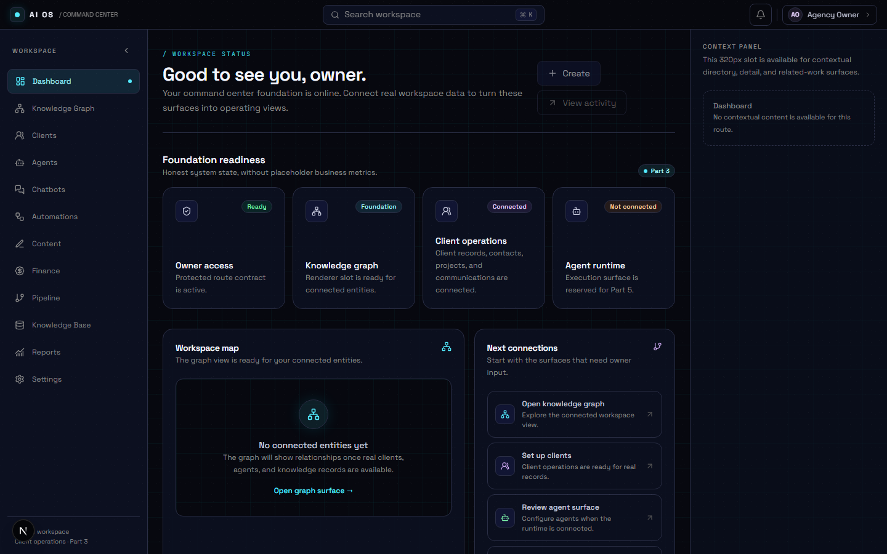
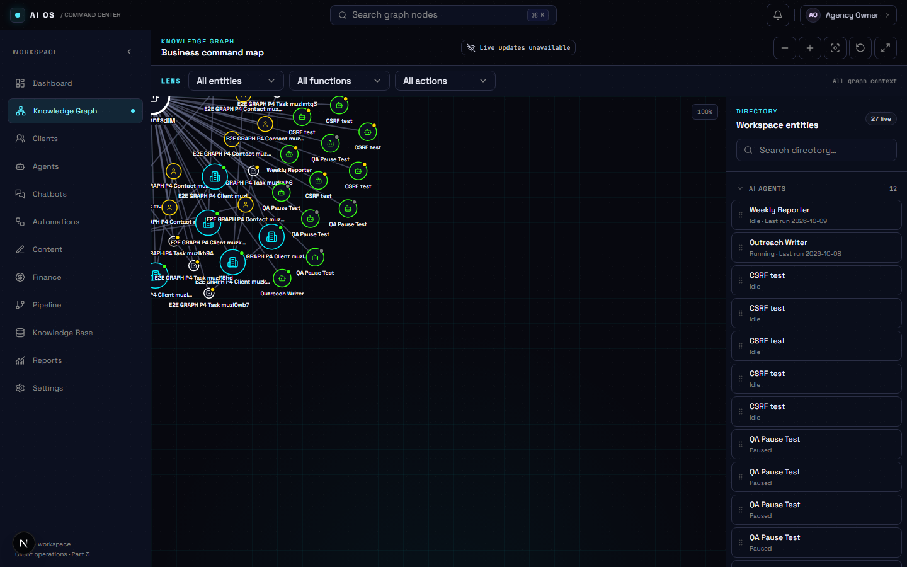
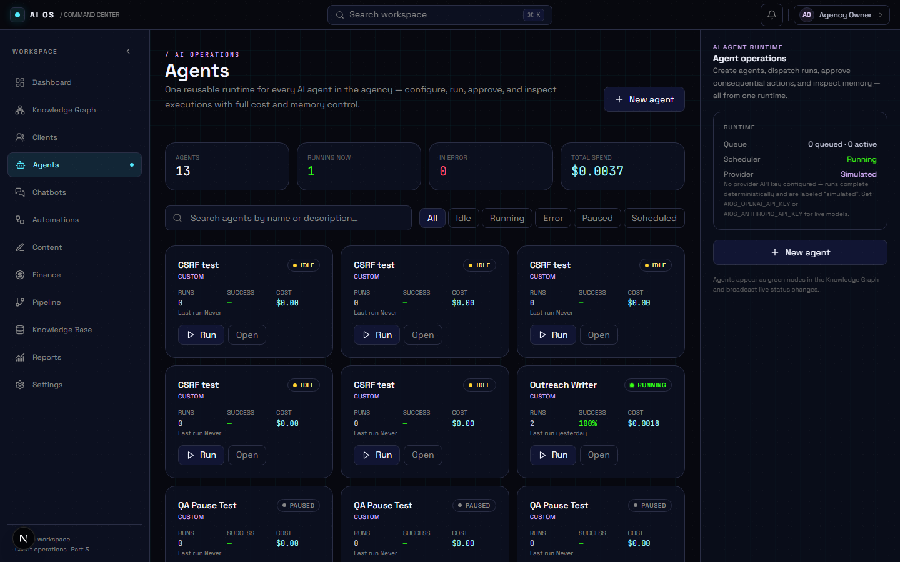
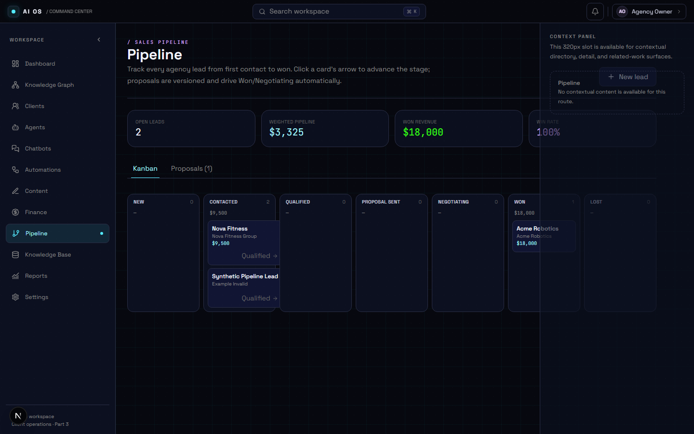

# AI Automation Agency OS

A private, AI-powered command center for running a one-person AI automation agency - clients, agents, chatbots, workflow automations, content, sales pipeline, finance, and operational knowledge in a single owner-only workspace.

> **Status:** Parts 1-11 of the 12-part roadmap implemented and verified (Part 12 = production deployment). 359 unit tests, 46 end-to-end tests, full OpenAPI contract coverage over 88 registered endpoints.

| Dashboard | Knowledge Graph |
|---|---|
|  |  |

| Agents | Pipeline |
|---|---|
|  |  |

---

## What it does

Every module is a full vertical slice - strict contracts, a transactional service layer with audit + durable outbox events, secured `/api/v1` endpoints with an OpenAPI contract, and a purpose-built UI.

| Module | Highlights |
|---|---|
| **Clients** | Lifecycle (prospect → active → churned), contacts, projects, tasks, deliverables with delivery gates, time tracking (manual + agent-run), communications with Gmail ingestion, invoices, archive/recover, soft-delete with 7-day recovery windows. |
| **Knowledge Graph** | Live command center - clients, agents, tasks, SOPs, knowledge, tools, finance nodes on a force-directed canvas with LENS URL filters, owner edge management, and realtime updates. |
| **AI Agents** | One reusable runtime: versioned configuration, durable queue with bounded concurrency, cron scheduler (per-minute idempotent), chained triggers with cycle protection, daily token budgets, cost ledger, persistent memory, hash-pinned human-in-the-loop approvals, run history with tokens/cost. OpenAI + Anthropic adapters, plus a clearly-labeled local simulation provider so everything works without keys. |
| **Chatbots** | Client chatbots built from pasted knowledge: automatic Q&A extraction → owner review → deployment gate → grounded conversations. Answers come only from approved Q&A with explainable confidence; below-threshold questions escalate instead of improvising. |
| **Automations** | n8n/Make workflow blueprints with a validation engine (reachability, cycle detection, unsafe-action flags, credential warnings), test-before-activate lifecycle, HMAC-verified provider execution webhook, health metrics, and templates. |
| **Content** | Scoped brand voices (client vs agency never mix), nine content types, a server-enforced approval state machine where any edit resets approval, version history, and a publishing calendar. |
| **Pipeline** | Kanban CRM (7 stages, click-to-advance, full stage-history audit), weighted pipeline value and win rate, versioned proposals whose acceptance moves the lead to Won automatically, deduplicated sourced leads with fit scoring. |
| **Finance** | Invoices with server-verified line-item totals, payments that close invoices automatically, expenses, and a dashboard (MRR, settled revenue, margin, outstanding, AI spend) plus per-client profitability - every number recomputes from source records. |
| **Knowledge & SOPs** | Versioned Markdown entries with keyword **and semantic search** (local embeddings - no external API), access counting, SOP checklists whose executions record the exact SOP version. |
| **Notifications & Reports** | Durable notification records with dedupe keys fired by real events (agent errors, new leads, overdue invoices), live bell with unread state, and a weekly business report computed from verified data. |

---

## Self-contained by design

This project runs **fully without external accounts**. Where a SaaS integration would normally be required, there is a built-in local alternative:

| Normally needs | Built-in alternative |
|---|---|
| OpenAI / Anthropic API keys | Deterministic local simulation provider (runs are labeled `simulated` in the UI) |
| Embedding API for semantic search | Local hashed-embedding model (`local-hash-v1`, same 1536-dim pgvector storage) |
| Stripe for payments | Manual payment recording that closes invoices and feeds the dashboard |
| LinkedIn/X/WordPress/Mailchimp for publishing | Manual publishing with local publish-event records |
| SMTP/SendGrid for outreach email | Approved sequences stay draft-only; nothing sends without a provider |
| n8n / Make instances | Blueprint editor, validator, sandbox tests, and the execution-event webhook all work locally |

The **Settings page** shows every integration with an honest configured / not-configured state and the exact environment variables to enable it. Adding a key lights up the real integration through the existing seams - no code changes.

---

## Tech stack

- **App:** Next.js (App Router) · React 19 · Tailwind CSS v4 · TanStack Query
- **API:** `/api/v1` only - bearer/cookie auth, Zod validation, idempotency keys, response envelope, cursor pagination, OpenAPI 3.1 with drift-checked route registry
- **Data:** PostgreSQL + pgvector, Prisma 7 with a transactional service layer, audit events, and durable outbox → Supabase Realtime broadcasts
- **Runtime:** monorepo packages - `contracts` (Zod), `data` (services), `agents` (runtime), `clients`, `graph`, `integrations`, `jobs`, `platform`, `observability`
- **Auth:** Supabase session auth, single active owner, CSRF-protected mutations, rate limiting (Upstash in prod / in-memory locally)
- **Quality:** Vitest unit suites, Playwright e2e across desktop/tablet/mobile with axe accessibility checks, production build gate

---

## Quickstart

Prerequisites: **Node 20+**, **Docker** (for Postgres + pgvector).

```bash
# 1. Database (Postgres 16 + pgvector)
docker run -d --name aios-postgres \
  -e POSTGRES_PASSWORD=aios-local-dev -p 54329:5432 pgvector/pgvector:pg16

# 2. Install
npm ci

# 3. Environment
cp apps/web/.env.example apps/web/.env.local

# 4. Migrate, seed, bootstrap the single owner, and populate demo data
npm run db:migrate:deploy
npm run db:seed
npm run db:seed:demo
npm run db:bootstrap-owner

# 5. Run (development auth bypass; never active in production)
export AIOS_AUTH_BYPASS=development-shell
npm run dev
```

Open **http://localhost:3000** - the workspace arrives with demo data: a client, an agent with run history and memory, a CRM lead, a paid invoice, embedded knowledge entries, an SOP checklist, approved content, and a tested workflow.

### Optional: real AI models

```bash
# In apps/web/.env.local - replaces the simulation with live completions
AIOS_OPENAI_API_KEY=sk-...
# or
AIOS_ANTHROPIC_API_KEY=sk-ant-...
```

Every other integration (Stripe, email, publishing, n8n, messaging channels) follows the same pattern: add the environment variables listed on the Settings page and restart.

---

## Repository layout

```
apps/web                  Next.js application (App Router) - UI + /api/v1 routes
packages/contracts        Zod schemas: DTOs, inputs, queries, realtime events
packages/data             Prisma schema/migrations + transactional domain services
  src/agents              Agent service, runtime-internal operations, graph projection
  src/chatbots|workflows|content|pipeline|finance|knowledge
  src/clients|graph       Client operations and knowledge-graph projection (Parts 3-4)
  src/vector.ts           pgvector helpers
packages/agents           Agent runtime: provider gateway (OpenAI/Anthropic/local),
                          executor, in-process queue, cron scheduler, tool registry
packages/clients          Client lifecycle business policy
packages/graph            Graph registries, LENS filtering, renderer policy
packages/integrations     Provider-isolated Gmail OAuth/history adapters
packages/jobs             Durable workers: deletion, outbox publisher, Gmail, realtime
packages/platform         Audit, webhook, idempotency, encryption, export contracts
packages/observability    Correlation IDs, structured logging, redaction
supabase/migrations       Storage bucket + owner policy provisioning
docs/                     Specification, roadmap, ADRs, runbooks, coverage, screenshots
tools/                    Roadmap/DOCX generation, OpenAPI drift check, bundle check
```

---

## Live demo deploy

The app is a standard Next.js deployment. To host your own public demo (Vercel + any free Postgres with pgvector, e.g. [Neon](https://neon.tech)):

1/6 Linking the Vercel project...

> npx vercel link --yes

The script runs migrations and seeds against the cloud database, sets every environment variable (including generated encryption keys), deploys, and prints the URL.  activates a read/write public demo: auth is bypassed by the explicitly-gated demo owner, an amber "Demo workspace" banner is shown, and the Settings page reports the honest integration posture. Remove the variables (or set ) to require real Supabase login again.

---

## Verification

```bash
npm run typecheck        # strict TypeScript across all workspaces
npm run lint
npm run test             # 359 unit tests (Vitest)
npm run test:e2e         # 46 Playwright tests (desktop/tablet/mobile, axe checks)
npm run openapi:validate # route registry <-> OpenAPI drift check (88 endpoints)
npm run build            # production build gate
npm run check            # everything above in one gate
```

Security posture: owner-only API (single active owner account), CSRF-protected mutations, rate limiting, secret redaction in logs, encrypted credentials via Supabase Vault, malware-scan pipeline for uploads, and human-approval gates before any consequential automation.

---

## Documentation

- [`docs/specification/`](docs/specification) - source SRS (`AI_Automation_Agency_OS_SRS.docx`)
- [`docs/roadmap/`](docs/roadmap) - the 12-part master roadmap and build prompts
- [`docs/traceability/`](docs/traceability) - per-part requirement coverage matrices
- [`docs/evidence/`](docs/evidence) - dated handoff reports with actual command results
- [`docs/adr/`](docs/adr) · [`docs/runbooks/`](docs/runbooks) - architecture decisions and operating procedures

---

## Honest limitations

- **Single-operator** by design (SRS scope); multi-tenant is future work.
- **External adapters are contract-shaped but not live** without credentials: Stripe payment pages, email sending, social publishing, n8n/Make deployment APIs, WhatsApp/Instagram channels. The Settings page states each one's exact posture.
- **Knowledge-graph canvas** covers Parts 3-4 entity types; chatbot/workflow/content/lead nodes are a documented follow-up.
- The **development auth bypass** (`AIOS_AUTH_BYPASS=development-shell`) and in-memory rate limiting are hard-rejected in production builds.

---

## License

Private project. All rights reserved.
