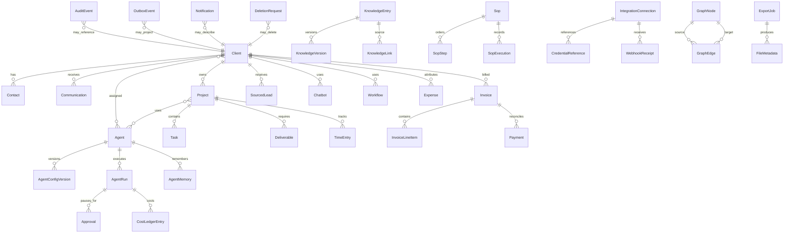

# Entity Relationship Overview

The full field-level dictionary is generated from Prisma. This overview emphasizes domain ownership and high-value relationships.

Polymorphic audit, outbox, notification, export, and deletion references use entity type plus entity ID where an ordinary foreign key cannot represent every domain table. Domain services validate those references. Graph edges use composite foreign keys into `GraphNode`, so endpoints and declared node types cannot disagree. Ordinary ownership relationships use actual foreign keys.
